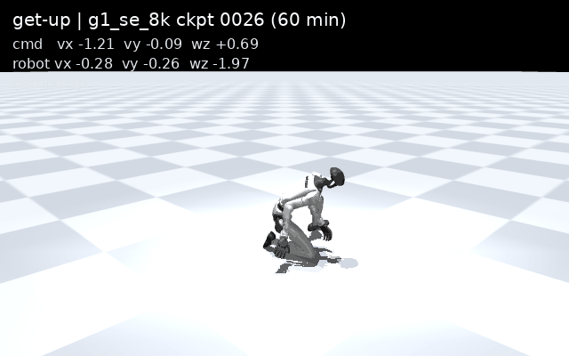

# InstantAMP: Train AMP in 30 minutes on 1 RTX 5090

InstantAMP trains a Unitree G1 velocity-tracking policy with an **adversarial motion prior (AMP)** in about 30 minutes on a single
RTX 5090. The policy walks, runs, side-steps and turns like the human clips it learns from, and it gets back up after a fall.

The policy is not trained with model-free RL alone. Like [SuperMimic](https://github.com/HybridRobotics/supermimic), InstantAMP fits a
**differentiable world model** of the robot from simulator transitions. The policy is then optimized with **analytic gradients through
short imagined rollouts** (backpropagation through time). The style rewards of the two motion priors are differentiable in the
imagined states too, so the policy follows their gradient through the world model like any other reward term.

The whole training loop is compiled with JAX, including the [MuJoCo Warp](https://github.com/google-deepmind/mujoco_warp) simulator,
and runs on one GPU. The code builds on [XSoma](https://github.com/nico-bohlinger/xsoma).

## Contents

- [What is trained](#what-is-trained)
- [Results](#results)
- [Setup](#setup)
- [Motion data](#motion-data)
- [Training](#training)
- [Flags](#flags)
- [Evaluation and rendering](#evaluation-and-rendering)
- [Repository layout](#repository-layout)
- [Acknowledgements and citation](#acknowledgements-and-citation)
- [License](#license)

## What is trained

| Part | What it is |
|---|---|
| Robot | Unitree G1, 29 joints. mjlab's MJCF with full collision (self-collisions included) and the Unitree actuator model (torque-speed curve and friction), 200 Hz physics, 50 Hz policy. |
| Task | Follow velocity commands on flat ground: vx ∈ [−1.5, 3.0] m/s, vy ∈ [−1, 1] m/s, wz ∈ [−π/2, π/2] rad/s. 25 % of the envs use heading control and 5 % stand still. Commands are redrawn every 3 to 8 s. |
| Observation | 4 frames of history (384 values): pelvis angular velocity, gravity, command, joint positions and velocities, last action. Noise is added, and the policy normalizes the observation with running statistics. |
| Rewards | Velocity tracking on the pelvis, regularizers (joint acceleration, joint limits, action rate, foot slip, self-collision, wrist pose), a termination penalty, and a rise penalty while the robot is down. |
| Falls and get-up | An upright robot is terminated as soon as its pelvis, hips, shoulders, torso or hands touch the floor. 20 % of the resets start on the floor in a frame of a LAFAN1 get-up clip, and the robot has 5 s to stand up. |
| Robustness | Pushes every 5 to 10 s, shoves at reset, randomized foot friction, encoder bias and torso CoM. |
| Motion priors | Two WGAN-GP discriminators over 10-frame windows: one for walking and running (used while the robot is up) and one for getting up (used while it is down). |
| Learner | World model (MLP 3×512, 8-step open-loop loss), BPTT over a 48-step horizon (about 1 s), a critic that bootstraps the return at the horizon, an ODE actor, and a hybrid PPO term on 10 % of the real collector steps. |

The reward that the policy maximizes in imagination is

```
r = (1 − amp_lerp) · r_task + amp_lerp · dt · (ramp · gate_loco · style_loco + gate_getup · style_getup)
```

- `gate_loco = moving · (0.25 + track_lin)` while the robot is up, so tracking well earns more style reward. It is 0 for a standing command.
- `gate_getup = 1` while the robot has not been up yet in its episode.
- Each style is `(1 + tanh((d − mean robot score) / 5)) / 2`. Centering it on the robot's own mean score keeps the reward slope constant, however far the robot still is from the demos.

## Results

<p align="center">
  
  
</p>


The GIFs and curves above come from a 60-minute run on one RTX 5090 with 8192 environments. The GIFs show its final checkpoint.
The curves are measured on 512 robots × 20 s per checkpoint, while the robots are up and commanded to move. Episodes are close to
full length (1000 steps) from about 20 minutes on. The velocity error falls to about 0.45 m/s at 30 minutes and 0.35 m/s at 60
minutes.

The table below is the reference run: one RTX 5090 with 4096 environments and the default flags. Compilation took 146 s before
training started, and training ran at 3.4 iterations per second.

| Training time | Episode length (of 1000 steps) | Episodes ending in a fall | Linear tracking (per s) | Get-ups (rose / down starts) |
|---|---|---|---|---|
| 5 min | 85 | 1.00 | 0.008 | 80 / 485 |
| 10 min | 152 | 1.00 | 0.021 | 100 / 117 |
| 15 min | 810 | 0.23 | 0.40 | 34 / 35 |
| 20 min | 949 | 0.07 | 0.70 | 40 / 40 |
| **30 min** | **935** | **0.10** | **0.73** | 27 / 33 |
| 60 min | 993 | 0.01 | 0.80 | 20 / 20 |

The robot learns to get up first (by about 10 minutes) and walks from about 15 minutes on. We rolled out the checkpoint from about
55 minutes for 20 s in 256 environments. It ran upright and symmetrically, with its arms swinging at its sides, at commands up to
2.7 m/s. Its median velocity error was 0.17 m/s, and it fell once.

These numbers come from one seed. Expect some spread between seeds and GPUs.

## Setup

You need Linux with an NVIDIA GPU, Python 3.11, and an NVIDIA driver with CUDA 12.8 support or newer. Warp's PyPI wheel needs
driver 580 or newer; the reference run used 580.

```bash
git clone https://github.com/RoboticsResearchHubVN/InstantAMP.git
cd InstantAMP
python3.11 -m venv .venv && source .venv/bin/activate
pip install -r requirements.txt
```

With an older driver, install Warp's CUDA 12 build (`warp_lang-1.19.0+cu12`) from
[its releases](https://github.com/NVIDIA/warp/releases) instead of the PyPI wheel.

Check the install on the CPU (no GPU or data needed):

```bash
JAX_PLATFORMS=cpu python -m pytest tests
```

## Motion data

The clips are not part of this repository; their own licenses apply. One script downloads them and converts them to 50 Hz `.npz`
files in the G1's joint order. It needs `git`, `git-lfs` and `curl`.

```bash
bash tools/download_data.sh
```

| Folder | Clips | Used for | Source |
|---|---|---|---|
| `data/amp/walk_run` | 30 clips, 156 s: walking, turning, side-stepping, running, running backwards, transitions | demos of the locomotion prior, upright reset frames | [legged_lab](https://github.com/zitongbai/legged_lab) (GMR retargets of AMASS / ACCAD) |
| `data/recovery/lafan1` | 6 `fallAndGetUp` takes, 935 s (24 056 ten-frame windows in which the robot is down) | demos of the get-up prior, floor reset frames | [Unitree's LAFAN1 retarget](https://huggingface.co/datasets/lvhaidong/LAFAN1_Retargeting_Dataset) (LAFAN1 by Ubisoft La Forge, CC BY-NC-ND 4.0) |

To use your own clips, convert them with [`tools/convert_motions.py`](tools/convert_motions.py) and pass their folders with
`--amp_dir` / `--walk_dir` (locomotion) or `--amp_getup_dir` / `--floor_dir` (get-up). The script reads legged_lab pickles
(`amp`) or Unitree-style CSV files (`csv`: root position, root quaternion x y z w, then the 29 joints, 30 fps by default). An
`.npz` clip holds `fps` (50), `root_pos`, `root_quat` (x, y, z, w), `root_lin_vel`, `root_ang_vel` (world frame), `dof_pos` and
`dof_vel` (29 joints in the order of `instantamp/env.py`'s `DOF`).

## Prepare the G1 and Zenbot get-up releases

Run these commands from the InstantAMP checkout after installing the Python dependencies. Both players use the same ten source motions. The G1 converter also writes the native-rate samples needed by training. The Zenbot retargeter builds the 23-joint reference from the converted G1 motions. The original clips are obtained from LeggedLab.

```bash
mkdir -p data/raw
git clone --filter=blob:none --no-checkout --sparse https://gitee.com/chaomingsanhua/legged_lab.git data/raw/legged_lab_getup
git -C data/raw/legged_lab_getup sparse-checkout set scripts/tools/retarget/config source/legged_lab/legged_lab/data/MotionData/g1_29dof/amp/get_up
git -C data/raw/legged_lab_getup checkout --detach f5f54fe506d7c2e558e07163fd6624ae3d44bbed
.venv/bin/python -m pip install joblib
.venv/bin/python -m tools.prepare_g1_getup data/raw/legged_lab_getup
.venv/bin/python -m tools.retarget_g1_zenbot
```

Install the checksum-verified Unitree surfaces for the G1 viewer with `bash tools/download_meshes.sh`. The Zenbot viewer reads 26 STL surfaces from the same 43 kg robot as the physics model. To prepare these from the robot source checkout, use a Git account with access to that repository, or set `zenbot_src` to an existing checkout containing the matching model.

```bash
zenbot_src=data/raw/h1_train_zenbot
git clone --filter=blob:none --no-checkout --sparse https://github.com/ZPLcode/h1_train.git "$zenbot_src"
git -C "$zenbot_src" sparse-checkout set robolab/data/robots/roboparty/zenbot
git -C "$zenbot_src" checkout --detach aafe0101ade37656f5390a7320bbd026f1f3c171
zenbot_robot="$zenbot_src/robolab/data/robots/roboparty/zenbot"
cmp assets/zenbot_23dof_43kg.xml "$zenbot_robot/mjcf/zenbot.xml" && \
  cp -R "$zenbot_robot/meshes" data/zenbot23_getup/
```

The Zenbot viewer and evaluator assemble the three committed checkpoint parts on first use and verify the SHA-256 in the release manifest. To materialize the original `runs/zenbot23_amp_ground_release/ckpt/0000.npz` for another tool, run `python3 -m tools.restore_zenbot_getup`. [Zenbot checkpoint parts](runs/zenbot23_amp_ground_release/ckpt) · [Release manifest](runs/zenbot23_amp_ground_release/release.json)

Zenbot builds its native controller on first use with a C++17 compiler and OpenMP (GCC on Linux). Start either interactive viewer from the repository root.

```bash
.venv/bin/python -m tools.play_getup
.venv/bin/python -m tools.play_zenbot_getup
```

## LeggedLab G1 get-up

The G1 training task uses a weight of −0.015 for the sum of squared changes between consecutive
29-joint actions. This triples the original LeggedLab get-up weight of −0.005 at the same 50 Hz
control rate. This change takes effect when training a policy.

Run `LeggedLab-Isaac-AMP-G1-GET-UP-v0` from the InstantAMP repository root. The source task is
registered on LeggedLab's `dev/get_up` branch (commit `f5f54fe`). Prepare its ten
positive-weight clips from a local checkout once. Only the preparation step needs
`joblib`. The converter writes a 50 Hz evaluation bank in `data/g1_getup/recovery`
and keeps the source-rate motion samples in its `native/` subdirectory for training.
[LeggedLab source at f5f54fe](https://gitee.com/chaomingsanhua/legged_lab/tree/f5f54fe).

```bash
.venv/bin/python -m pip install joblib
.venv/bin/python -m tools.prepare_g1_getup ../legged_lab
.venv/bin/python -m instantamp.train --task LeggedLab-Isaac-AMP-G1-GET-UP-v0 --log_dir runs/g1_getup_example
.venv/bin/python -m instantamp.evaluate runs/g1_getup_example --last 1
```

The task uses 29 joints, 200 Hz MuJoCo Warp physics, 50 Hz policy control and 10-second episodes.
Each reset samples a clip uniformly and a continuous time in that clip, restores its interpolated pose and velocities,
and adds 0.10 m to the root height. Joint targets use the source default pose plus 0.25 times the action.
The named task uses the source Unitree G1 rev 1.0 joints, inertia and collision bodies,
including the soles and hands. MuJoCo represents the source mesh colliders using convex hulls.
The converted model is `assets/g1_leggedlab.xml`. The conversion is in `tools/convert_leggedlab_g1.py`.
The standing reward activates above 0.65 m and targets 0.75 m. During training a persistent
upward force acts on the torso. It starts at 200 N, and when the resetting environments
exceed 60% of the maximum mean height reward their assistance drops by 10 N.

The actor takes five noisy observations (570 values). The critic takes five clean observations
including body-frame linear velocity and root height (590 values). The LSGAN discriminator sees ten
85-value frames, with six pelvis-relative landmarks. Task and style rewards have equal weight and
the style scale is 50. The policy emits a joint offset at each control step
(`--ode 0`). InstantAMP's native learner updates the policy using world-model rollouts
and real PPO data. Checkpoints use the InstantAMP format. The default
run uses 4,096 environments and a 500,000-iteration limit. Use `--max_iterations` to bound a run.

Evaluation sets assistance to zero and scores 15 fixed fallen starts. Success requires a pelvis
height in (0.65, 0.85] m and a tilt below 30 degrees throughout the final second, with the feet
supporting at least half of body weight on at least 45 of its 50 steps.

To compare the movement with AMP, use `--starts source-play`. This uses
the ten frame-zero starts from the source PLAY config, nominal physics and clean
sensor observations. For the same starts with randomized torso mass, materials
and noisy actor observations, use `--starts source-play-world --world-seed 42`.
Both evaluations set the torso assistance to zero.
The additional `fallen` protocol uses two offsets for clips below the fallen
height cutoff. The comparison pairs the actual simulated poses with the
source motion at the same time and reports height, tilt, joint and landmark
errors throughout the motion. Both camera views share the same floor, axes
and clock. The controller runs through the full ten seconds for the standing
score, including the time after the reference ends.
Pass `--show-hold` to the comparison video command to watch the policy continue through
the full episode, with the final source frame held and labeled on the left.

```bash
run=runs/g1_getup_example
.venv/bin/python -m instantamp.evaluate "$run" --last 1 --starts source-play --trajectories "$run/rollouts"
# Use the checkpoint number printed during evaluation.
.venv/bin/python -m tools.compare_recovery_rollouts "$run/rollouts/NNNN_avg_source_play_recovery.npz" \
  --out "$run/style.json" --video "$run/reference-vs-policy.mp4"
```

The source PPO comparison can be run with `.venv/bin/python -m instantamp.train_g1_getup_amp`.
It trains in the same MuJoCo Warp environment using real 24-step rollouts, an ELU actor
with raw observations, a Gaussian action distribution, a privileged critic and an AMP
discriminator. It starts from random weights and exports policies for the same evaluator.
The following single-GPU command reproduces the training settings of the source-motion
comparison and writes checkpoints at iterations 3,000 and 3,750. GPU contact dynamics
can vary between runs with the same seed.

```bash
.venv/bin/python -m instantamp.train_g1_getup_amp --num_envs 512 --disc_batch 768 \
  --iterations 3750 --save_every 250 --log_dir runs/getup_ppo_reproduction
.venv/bin/python -m instantamp.evaluate runs/getup_ppo_reproduction \
  --checkpoint 003000.npz --starts source-play --trajectories runs/getup_ppo_reproduction/rollouts
```

For a separate fine-tuning run, `--init_policy` imports an exported actor and preserves its
observation preprocessing. With reference rewards enabled, the optional `--rise_anchor`
penalizes changes to that actor's actions during source-matched, low-pelvis transitions.
The actor still takes only robot observations at deployment.

For a zero-assistance training run, set `--assist_newtons 0`. The optional
`--reference_weight` adds a training reward for following the reset clip from
its sampled frame and holding the final standing pose. Both trainers accept
`--reference_hold_scale`. Its default of 1 keeps the full weight after playback.
A value of 0.05 gives the held pose 5% of that weight after the last source frame.

The optional standing fine-tune trains on physical states recorded during the rise. Its
PPO reward uses pelvis height, orientation, foot support, root motion and horizontal
displacement. The actor uses the same five observation frames as the get-up actor.
Each bank entry is a simulated trajectory at `BANK/<trajectory>/rollout.npz` with
`qpos` and `qvel` in the named G1 model's joint order.

```bash
.venv/bin/python -m instantamp.train_g1_stance --init-policy STANDING_ACTOR.npz \
  --bank runs/g1_getup_ref_planning/source_starts --log-dir runs/stance_finetune \
  --envs 256 --iterations 250 --save-every 25
.venv/bin/python -m instantamp.evaluate runs/g1_getup_stand_release \
  --last 1 --starts fallen --seconds 30 --trajectories runs/stand_validation
```

The packaged controller starts with the 3,000-iteration rise actor. It can then hand
control to the balance and stationary actors according to ankle depth, torso orientation
and angular speed. The standing actors can filter five sensor frames and reconstruct
landmarks from measured joint angles. The evaluation records post-rise falls, foot loads
and horizontal displacement over an uninterrupted rollout.

Run the G1 ground-to-stand policy in an interactive MuJoCo desktop window from the
repository root. The viewer loads `runs/g1_ground_sequence_release/ckpt/0000.npz`.
The controller combines the PPO+AMP motor policy, a threefold action-rate penalty
and trajectory feedback that uses MuJoCo root and contact measurements. For
reference motions that use the hands, it checks palm load before extending the legs.
The overlay shows the vertical load at each palm as a percentage of body weight.
The release includes real-time reference comparisons, contact timing and post-rise
displacement from the physical rollouts. [G1 release report](runs/g1_ground_sequence_release/README.md)

```bash
.venv/bin/python -m tools.play_getup
```

The window opens paused at the first source start. Space plays or pauses, R restarts that
motion, N selects the next start and Enter applies a 0.20 m/s horizontal velocity impulse.
To apply a force with the mouse, double-click the torso and hold Ctrl while dragging with
the right mouse button. Left-drag orbits the camera and the mouse wheel zooms.
The policy runs at 50 Hz with native CPU MuJoCo physics at 200 Hz. Use `--trial 0`
through `--trial 9` to pick a starting motion.

To watch the robot run, fall, stand and resume in one continuous simulation, run
the command below. Set `--speed .55` for walking. The test pushes the torso at
6 seconds by default. The recovery controller detects a fall from orientation
and ground contact, including falls caused by dragging in the viewer. Once the body
lands, it runs the PPO+AMP controller in separate MuJoCo states initialized from the
measured pose and velocity. It compares short damping intervals and initial joint
targets, then executes the selected entry with normal motor limits. The recorded
results include failed rises before the first stand, palm contact before knee
extension, and forward speed after the gait resumes.

```bash
.venv/bin/python -m tools.evaluate_g1_walk_recovery --speed 2.15 --direction 90 --viewer
```

#### Reproduce the G1 palm-supported recovery policy

The packer combines the saved 29-motor PPO+AMP correction with feedback trajectories
from native MuJoCo. Each bank contains measured poses and velocities, servo actions,
local feedback gains and the frame at which standing control takes over. The manifest
lists the motor checkpoint, ordered banks and matching teacher starts for each recipe.
The packer checks the initial joint angles against the source clip and offset, then
derives the reference palm windows from the G1 collision geometry at 0.02 s per frame.
The live controller measures palm load and adds the trained motor correction on each
tracking step. [Packing recipes](assets/g1_ground_sequence_recipes.json)

The published G1 weights, fine-tuning inputs and training logs are included in this branch. The packing commands below use the archived development checkpoints, teacher starts and feedback banks at the paths listed in the manifest. With that development archive present, the comparison checks every checkpoint field, including its data type and motor weights.

```bash
recipe=hand_supported_stance
.venv/bin/python -m tools.pack_g1_ground_policy "$recipe" \
  --out "runs/rebuilt/$recipe" \
  --compare "runs/g1_getup_inplace_candidate/$recipe/ckpt/0000.npz"
```

`hand_final4_dev` packages the trained motor correction and four physical feedback
banks. `hand_supported_stance` derives mode 9 from that package and evaluates foot
support during the predicted stance. `hand_supported_impulse` derives mode 10 from
the frozen mode 9 checkpoint and enables a bounded motor response to an unexpected
impulse in quiet stance. `hand_amp_balance` derives mode 11 from mode 10 and can
hand control to the learned AMP balance actor when the predicted stance fails.
`hand_grounded_balance` derives mode 12 from mode 11 and reacquires the loaded
foot positions after an AMP balance step. `hand_grounded_recovery` derives mode 13
from mode 12 and waits for one second of calm supported stance after a sudden push
before looking for a sustained disturbance again.
These exports preserve the learned motor weights. To use a
different copy of the frozen source, supply it directly to the same exporter.

```bash
.venv/bin/python -m tools.export_g1_supported_stance \
  runs/rebuilt/hand_supported_stance/ckpt/0000.npz --absorb-impulse \
  --out runs/rebuilt/hand_supported_impulse \
  --compare runs/g1_getup_inplace_candidate/hand_supported_impulse/ckpt/0000.npz
```

To repeat the ground-phase PPO fine-tune on top of `hand_sequence30`, the command
below stretches the real demonstration by a factor of 1.35 and trains with measured
palm loading, joint tracking and the threefold action-rate penalty. A training update
collects 1,400 native control steps. The `hand_final4_dev` recipe uses update 5 of 12.

```bash
.venv/bin/python -m tools.train_g1_tracking_residual \
  --base runs/g1_getup_inplace_candidate/hand_sequence30/ckpt/0000.npz \
  --discriminator runs/g1_getup_polish/style/amp6_rate3/discriminator/000060.npz \
  --out runs/retrained_ground_ppo --envs 4 --steps 350 --iterations 12 --seed 508791 \
  --scale 0.06 --std 0.16 --lr 0.00015 --reference-motion-weight 3 \
  --rise-duration-scale 1.35 --ground-support-weight 7
.venv/bin/python -m tools.pack_g1_ground_policy hand_final4_dev \
  --motor runs/retrained_ground_ppo/000005/ckpt/0000.npz --out runs/retrained_ground_policy
```

To measure that same player's motion without opening a window, run the ten source starts
and fifteen low starts for thirty seconds each. The default checkpoint follows the
interactive viewer. Pass `--checkpoint PATH` to compare a different policy.

```bash
.venv/bin/python -m tools.verify_getup_player record --out runs/native_getup_check
.venv/bin/python -m tools.verify_getup_player score runs/native_getup_check/source-play.npz
```

The first command writes one replay archive and one per-trial `*-metrics.json` per
protocol. The second recomputes metrics from an existing native-player recording.
The reports include the checkpoint, physics and source-clip hashes. Pose and speed
errors use matched timestamps through the reference rise. Foot travel sums both
ankle paths in the moving pelvis frame. Knee reversals count extrema of either
knee with at least 0.1 rad of prominence. The first quiet time starts a continuous
one-second interval with torso tilt below 15°, pelvis horizontal speed below 0.08 m/s,
ankle horizontal speeds below 0.05 m/s, arm joint RMS speed below 0.4 rad/s,
pelvis height between 0.65 and 0.85 m, and bilateral floor support. Use
`--push-at 15` for the viewer's impulse or `--jitter-seed 714` to reproduce the
perturbed reset suite.

```bash
.venv/bin/python -m tools.compare_recovery_rollouts runs/native_getup_check/source-play.npz \
  --trial 0 --show-hold --out runs/native_getup_check/comparison.json \
  --video runs/native_getup_check/comparison.mp4
```

For the three-column reference, old policy and new policy comparison, append
`--baseline-archive PATH_TO_OLD_SOURCE_PLAY_NPZ` from a run with the same starts,
perturbations and duration.

To compare checkpoints across six repeatable reset perturbations, use the benchmark
command below. It keeps each trial's metrics and a per-seed summary under
`runs/g1_getup_multiseed/selection`, and reuses completed runs with the same checkpoint
hash. The two protocols share eight start poses. The combined count uses each
clip/offset once per seed.

```bash
.venv/bin/python -m tools.benchmark_getup_checkpoints --suite selection \
  --checkpoint live=runs/g1_getup_amp_rate3/ckpt/0000.npz
```

`--suite panel` covers the nominal starts and one development seed for a first
comparison. `--suite long` records 90 seconds from each source start with the push at
15 seconds, both nominally and with another perturbation. `--suite final` checks a
nominated checkpoint against five separately reserved reset seeds. Use
`--keep-recordings` on a fresh run to retain the full replay archives.
For completed runs with matching source and reset-state hashes, pass
`--suite final --compare CANDIDATE_LABEL BASELINE_LABEL` to count which individual
starts both policies passed and which passed with only one of the two policies.

To measure whether the robot stands **in place**, score the maximum horizontal
displacement from the first upright frame, including the first and second seconds.
The per-start report also gives loaded ankle displacement, reset-to-final drift,
actual reference duration and the 10, 20 and 30 cm pass counts. It records an
early failed attempt when the pelvis gains at least 10 cm, stays at or above
0.50 m for 0.10 s, then drops at least 12 cm and stays at or below 0.45 m for
0.10 s. A subsequent elevation or the first sustained upright posture confirms a
retry. The first-attempt counts require a rise without a retry or a later fall.

```bash
.venv/bin/python -m tools.score_getup_in_place runs/native_getup_check/source-play.npz \
  runs/native_getup_check/fallen.npz --out runs/native_getup_check/in-place.json
.venv/bin/python -m tools.score_g1_ground_phase runs/native_getup_check/source-play.npz \
  runs/native_getup_check/fallen.npz --out runs/native_getup_check/ground-phase.json
.venv/bin/python -m tools.score_g1_weight_transfer runs/native_getup_check/source-play.npz \
  runs/native_getup_check/fallen.npz --ground-phase runs/native_getup_check/ground-phase.json \
  --out runs/native_getup_check/weight-transfer.json
```

To compare policies on the same three development perturbations, specify each
checkpoint with its own label. The command uses 17 distinct starts per seed and
stores each start's 30-second result under `runs/g1_getup_in_place/dev`. Pass
`--keep-recordings` to retain the simulated motion and force samples as well.

```bash
.venv/bin/python -m tools.benchmark_getup_in_place --suite dev \
  --checkpoint selected=runs/g1_getup_amp_selected/ckpt/0000.npz candidate=PATH_TO_CANDIDATE.npz
```

To continue a native learner in a new run directory, pass `--init_full` with
its `ckpt/full/NNNN.npz` file and retain the matching actor export in `ckpt/`.
Use the same network widths and a higher absolute `--max_iterations`.
This restores the actor, dynamics model, critic, discriminator, optimizers and
counters. The actor input normalizer stays fixed. The new stage collects fresh
replay and starts its assistance curriculum at the specified `--assist_newtons`.
To import a different actor while continuing the learner, supply both `--init_full`
and `--init_policy`. The latter supplies the averaged policy and its input
normalizer, and starts the actor optimizer from zero. A positive `--rise_anchor`
uses this policy as a frozen action target on real PPO observations where the
source pelvis is low and its motion is still playing. Each target is weighted
by the squared post-step reference pose score. This requires `--reference_weight`
and `--ppo_frac` above zero. Policy exports contain the trained actor.

For a compatible InstantAMP actor warm start, pass `--init_policy`, select its
action mode and, for ODE actors, match the ODE limits. Fine-tuning keeps the actor's
input normalization fixed. The motion references supply the discriminator's expert
examples. Playback uses only robot observations and the trained policy.

The local source PPO run keeps the original get-up actor at
`runs/g1_getup_leggedlab_ppo/ckpt/003000.npz`. A separate native InstantAMP
run starts from an actor distilled on physical rollouts of the ten source motions
and continues with the original task and AMP rewards at zero assistance. Its
6,750-iteration export is `runs/g1_getup_native_motion_prior/ckpt/0001.npz`.
The earlier physical demonstrations trained the starting actor. The exported actor
uses only the five-frame robot observation. The distillation recipe is in
`runs/g1_getup_source_recipe/README.md` and the native learner settings are in
`runs/g1_getup_native_motion_prior/config.json`.

The two actors can be viewed on the [first ten-second episode](runs/g1_getup_native_motion_prior/evaluation/iter_006750/trial00_full_vs_ppo3000.mp4)
or across [all ten source clips](runs/g1_getup_native_motion_prior/evaluation/iter_006750/all10_vs_ppo3000.mp4).
On three repetitions of the ten nominal starts, the source PPO actor held the final
stance in 3–5 episodes and the native actor in 7–8. The long subject 2 rise still
varies considerably in its timing and final balance.

## Train the G1 baseline on recovery style

Start with a full 29-joint G1 InstantAMP checkpoint. The following recipe fine-tunes its actor with the
original world model, imagination gradients, real PPO updates and walking discriminator. It adds an AMP
discriminator that compares recovery windows at the same point in a native 50 Hz demonstration. The
reference clip, frame and reset transformation are training metadata. The deployed ODE actor uses its
standard four sensor frames (384 inputs) to control 29 joints.

```bash
python tools/prepare_g1_rises.py --lead-in-frames 40 --dst data/recovery/g1_rises_leadin40
python -m instantamp.train --robot g1 --g1_style 1 --num_envs 4096 \
  --init_g1_full runs/g1_4096_20261120_01/ckpt/full/0011.npz \
  --floor_dir data/recovery/g1_rises_leadin40/train --g1_support_friction 1 \
  --g1_phase_share .75 --reference_weight 0 --getup_reward_scale 38 --getup_disc_lr .00018 \
  --getup_style_ramp 120 --getup_rise_weight -.05 --getup_anchor .9 --getup_reset_frames 50 \
  --reset_floor .85 --imag_down .72 --pi_lr .000055 --pi_updates 2 --ppo_frac .20 --ppo_w 1.15 \
  --ppo_len 16 --pi_batch 512 --wm_batch 640 --amp_batch 640 --buffer_steps 100 \
  --wm_only_iters 100 --pi_ema .978 --env_steps 4 --log_every 50 --ckpt_minutes .85 \
  --max_iterations 3000 --minutes 0 --log_dir runs/g1_phase_amp
```

Of the rise-style reward, 75% comes from the phase-conditioned discriminator and 25% from the
unconditioned recovery discriminator. Positive examples are recorded G1 movements. Negative
examples come from the simulated policy. Pose tracking has weight zero in this recipe.
Fallen resets use a standing velocity command and the source recovery plus one second of balancing.
Walking resets continue to train locomotion. Hand and knee contacts use tangential friction.

Evaluate checkpoints on the 61 training clips before selecting one. Omitting `--clips-dir`
evaluates the 11 fixed starts from the take excluded from this fine-tuning bank. The original baseline
used that take in its larger, unsegmented motion corpus. The scorer applies the same contact settings
to both actors and measures wrist and ankle trajectories on the native clock. It reports a separate
one-second, foot-loaded standing check.

```bash
python tools/evaluate_g1_style.py BASELINE.npz CANDIDATE.npz --single-actor --support-friction \
  --clips-dir data/recovery/g1_rises_leadin40/train --count 61 --out runs/g1_phase_amp/train61.json
python tools/evaluate_g1_style.py BASELINE.npz CANDIDATE.npz --single-actor --support-friction \
  --out runs/g1_phase_amp/fixed11.json --trajectories runs/g1_phase_amp/fixed11.npz
python tools/render_g1_comparison.py runs/g1_phase_amp/fixed11.npz runs/g1_phase_amp/fixed11.json \
  runs/g1_phase_amp/fixed11.mp4 --show-hold
```

## G1 recovery style

The G1 recovery experiment uses the original 29-joint actor and native 50 Hz motions.
The preparation tool extracts 61 forward rises from five takes. It reserves the entire
`fallAndGetUp1_subject1` take for evaluation of the fine-tuning. The original G1
checkpoint was trained on all six untrimmed takes.

```bash
python tools/prepare_g1_rises.py
python -m instantamp.train --g1_style 1 --num_envs 4096 \
  --init_g1_full runs/g1_4096_20261120_01/ckpt/full/0011.npz \
  --buffer_steps 128 --amp_batch 1024 --wm_batch 768 --pi_batch 640 \
  --wm_only_iters 80 --pi_ema 0.99 --max_iterations 850 --minutes 0 \
  --ckpt_minutes 1000 --log_dir runs/g1_style_replica
python tools/export_g1_arm_blend.py runs/g1_4096_20261120_01/ckpt/0011.npz \
  runs/g1_style_replica/ckpt/0000.npz --out runs/g1_arm_recovery
python tools/evaluate_g1_style.py runs/g1_4096_20261120_01/ckpt/0011.npz \
  runs/g1_arm_recovery/ckpt/best.npz --out runs/g1_arm_recovery/comparison.json \
  --gif runs/g1_arm_recovery/comparison.gif
```

Fine-tuning starts from the averaged baseline actor and copies the world model,
observation statistics, critic, and walking discriminator. A new least-squares recovery
discriminator observes ten consecutive frames including pelvis height and vertical
velocity. It scores the first four seconds of a floor-start episode. Half the resets
come from the opening 0.4 seconds of a recovery. The commands above save the final
actor at iteration 850. In the original run, this actor is checkpoint 0001.

The exported policy blends up to 20% of the fine-tuned actor's shoulder, elbow and
wrist action increments into the baseline. Projected gravity and knee flexion set
the blend at each step. The baseline controls the waist and legs. Both actors use
their own observation statistics and share one action integrator. Load the export
through `instantamp.inference.load` and call `policy_output` before the usual ODE
integration. The native renderer and evaluator also accept the exported run directory.

On the eleven fixed starts from the reserved take, both policies stood up within
five seconds and stayed upright through seconds five to six. Comparing corresponding
fractions of the rise, median wrist error fell from 37.3 to 36.4 cm, ankle error
from 56.7 to 55.6 cm, and joint error from 0.704 to 0.683 rad. The reference took
2.34 s to rise at the median. The original and exported policies took 0.82 and
0.80 s. The comparison uses nominal physics and zero assistance.

### Following a specific G1 get-up

For a specified sequence of poses at 50 Hz, run the reference controller from
the repository root. Use the native G1 checkpoint to take over balance after
the last reference frame. Choose a new output directory for each run.

```bash
.venv/bin/python tools/plan_g1_reference.py --fixed --out runs/g1_reference_check --gif
# A single native G1 get-up, starting on the floor and ending in stance
.venv/bin/python tools/plan_g1_reference.py --clip path/to/getup.npz \
  --balance runs/g1_4096_20261120_01/ckpt/0011.npz --out runs/g1_one_reference
```

At each replan, 200 batched MuJoCo Warp predictions start from the measured state.
They evaluate 0.48 s of joint, pelvis and landmark tracking. A separate native
MuJoCo simulation executes three 20 ms control steps, then supplies its new state.
The robot uses its original motor torque and speed limits. Hand and knee contacts
with the floor can carry tangential force. The opt-in contact setting is scoped
to the reference task. The simulation initializes the floating base once.

The output NPZ contains the reference and simulated poses, velocities, 50 Hz
joint targets, and the actual actuator inputs for each 5 ms substep. The JSON
report compares trajectories at equal times from the fallen start through 0.5 s
after the reference first reaches the standing threshold. For the eleven fixed
starts, all eleven stood up unassisted and stayed upright throughout the final
second. Median across-trial RMS errors were 2.3 cm in pelvis height, 5.7° in
pelvis orientation, 6.2 cm at the wrists and 5.5 cm at the ankles in the world
frame. The largest rise-time difference was a single 20 ms control step.

For repeated execution of a planned clip, export the nominal joint targets and
a time-varying state-feedback gain for each 20 ms control step. The exported
controller uses NumPy at execution time and takes the measured floating-base
and joint state in the plan's coordinate system. A new clip needs its own plan.
The exported eleven-clip bank stood up and held stance on all eleven nominal
starts. It also held stance on all 22 validation starts with paired initial
height and horizontal speed offsets of ±5 mm and ±0.08 m/s. Across the nominal
trials its median wrist and ankle errors were 6.3 and 5.5 cm.

```bash
OPENBLAS_NUM_THREADS=1 .venv/bin/python tools/export_g1_tracking_policy.py \
  runs/g1_reference_check/trajectories_000.npz --out runs/g1_getup_feedback
.venv/bin/python tools/track_g1_reference.py feedback runs/g1_getup_feedback/policy.npz \
  fallAndGetUp1_subject1_458_565 --out runs/g1_feedback_replay.npz
```

```python
from instantamp.timed_feedback import TimedFeedbackPolicy

policy = TimedFeedbackPolicy.load("runs/g1_getup_feedback/policy.npz")
case = policy.names.index("fallAndGetUp1_subject1_458_565")
# qpos and qvel come from the robot at this control step.
joint_target = policy.target(case, tick, qpos, qvel)
```

The repository also supports the LAFAN1 anchor-conditioned SuperMimic G1 neural
policy if that checkpoint is available locally. Its inputs are ten reference
frames, the robot's sensor history and the reference torso pose relative to the
current torso. The export step uses the source checkout's PyTorch environment.

```bash
python tools/track_g1_reference.py export /path/to/ckpt_latest.pt g1_reference_actor.npz
.venv/bin/python tools/track_g1_reference.py run g1_reference_actor.npz \
  data/recovery/lafan1/fallAndGetUp1_subject1.npz --start 763 --end 942 \
  --seconds 6 --out runs/g1_actor_reference.npz
```

## Zenbot 23-DoF get-up

The `zenbot23_getup` task uses the 43.0678308 kg articulation from
`motion_train/robolab/data/robots/roboparty/zenbot`. The released policy uses [G1 get-up references retargeted to Zenbot](#prepare-the-g1-and-zenbot-get-up-releases). For a separate experiment using an existing native Zenbot `get_up_frax` database, the following commands prepare that database in its own directory and train with it.

```bash
python tools/prepare_zenbot.py /path/to/motion_train --legged-lab /path/to/legged_lab --dest data/zenbot23_frax
python -m instantamp.train --robot zenbot23_getup --num_envs 4096 \
  --walk_dir data/zenbot23_frax/recovery --amp_dir data/zenbot23_frax/recovery \
  --floor_dir data/zenbot23_frax/recovery --amp_getup_dir data/zenbot23_frax/recovery --log_dir runs/zenbot23_frax
python -m instantamp.evaluate runs/zenbot23_frax --last 1
```

For the released weights, the ten G1 LeggedLab recoveries supply the Zenbot demonstrations. The retargeter fits the physical
Zenbot joint ranges, limb lengths, foot, knee and hand heights and self-contact constraints. It preserves the
source timestamps and recomputes the six world-frame landmarks with Zenbot forward kinematics. The source
hashes and per-clip checks are in `data/zenbot23_getup/recovery/retarget.json`.

```bash
python -m tools.retarget_g1_zenbot --source data/g1_getup/recovery --dest data/zenbot23_getup/recovery
python -m tools.evaluate_zenbot_native --reference data/zenbot23_getup/recovery
```

Open the native Zenbot get-up policy in a MuJoCo window, or render the retargeted
reference and the closed-loop policy side by side. The default get-up controller combines
the 480-value actor history, a native PPO+AMP motor correction and trajectory
feedback using the measured floating-base state. It forecasts physically feasible motor
commands in copies of the MuJoCo state. The live simulation applies 23 torque-limited
motors with five sampled motor-group delays of 3–7 physics steps. The release uses
the G1 motions retargeted to Zenbot, real palm and sole contacts, and a threefold
action-rate penalty. The viewer shows left and right palm load as a fraction of body
weight. Its graphics use the 43 kg Zenbot
meshes in `data/zenbot23_getup/meshes`. Space plays or pauses, R restarts,
N advances to the next fallen start and Enter applies a horizontal impulse.
Double-click a body, then hold Ctrl and right-drag to apply a force.
The [Zenbot release report](runs/zenbot23_amp_ground_release/README.md) links the checkpoint, real-time videos,
contact measurements, training lineage and independent 30-second tests.

Record the same physical player for 30 seconds per start, score whether each get-up
uses the palms before extending the knees, and render a fixed-camera comparison.
Each random seed changes the joint and body angles, horizontal velocity and motor
group delays. Seed 42 uses the 17 standard initial poses.

```bash
.venv/bin/python -m tools.evaluate_zenbot_getup --seeds 42 --trajectories --out runs/zenbot_check
.venv/bin/python -m tools.summarize_zenbot_getup runs/zenbot_check --out runs/zenbot_check/summary.json
.venv/bin/python -m tools.render_zenbot_ground_phase runs/zenbot_check/42_00.npz --out runs/zenbot_check/first_getup.mp4
```

Pass `--no-plan-cache` in the viewer or evaluator to recompute a motor plan
from measured state. To regenerate a cache, record the same nominal poses with
`--save-plans`, then package the generated controls. Cache lookup requires
an exact match of all initial joint and root positions, velocities and motor delays.

```bash
.venv/bin/python -m tools.evaluate_zenbot_getup --checkpoint "$ZENBOT_CHECKPOINT" \
  --seeds 42 --trajectories --save-plans runs/zenbot_plan_check/plans --out runs/zenbot_plan_check/physical
.venv/bin/python -m tools.cache_zenbot_getup --checkpoint "$ZENBOT_CHECKPOINT" \
  --plans runs/zenbot_plan_check/plans --out runs/zenbot_cached_policy
```

```bash
.venv/bin/python -m tools.play_zenbot_getup --trial 0
MUJOCO_GL=egl .venv/bin/python -m tools.play_zenbot_getup --trial 0 --video runs/zenbot_comparison.mp4
```

The later of the two native PPO+AMP runs started from the first trained residual and a broader motion bank.
This command repeats its 300-update run in a separate directory. The release uses its update 50.

```bash
.venv/bin/python -m tools.train_zenbot_tracking --base runs/zenbot23_inplace/multiref2/ckpt/0000.npz \
  --iterations 300 --envs 80 --horizon 36 --seed 41887 --scale .14 --out runs/zenbot_native_retrain
```

The training command below uses the ten retargeted clips for the reset distribution, motion reference,
and the 10-frame, 73-feature AMP discriminator. The native CPU checkpoint evaluator runs the
23 torque motors at 200 Hz with the five actuator-group delays, a 50 Hz policy and zero assistance.

```bash
python -m instantamp.train --robot zenbot23_getup --num_envs 512 --action_rate_l2_weight -.015 --log_dir runs/zenbot23_g1_getup_amp
python -m tools.evaluate_zenbot_native --checkpoint runs/zenbot23_g1_getup_amp/ckpt/NNNN.npz --seconds 12
```

For a mixed recovery curriculum, `--zenbot_phase_resets .68 --zenbot_episode_steps 225` starts 68% of the worlds
at intermediate reference frames and the rest at the beginning of a get-up. The motion reward follows the sampled
frame and holds the final pose. A full learner checkpoint can continue in another log directory with `--init_full`
and a lower `--assist_newtons`. Record the assistance used during training alongside the independent CPU results.
Use `--starts standing` in the CPU evaluator for a separate balance test, or `--sensor-noise .25 --seed 79021`
to vary the five motor delays and apply one quarter of the training observation noise.

Preparation verifies the MJCF and clip checksums against the `get_up_frax` manifest, maps named joints into MuJoCo hinge order,
and resamples the 11 selected 30 Hz recoveries to 50 Hz. Meshes are optional for training.
Resets sample the clips equally, center the pelvis in XY and start at the first frame with a 2 cm lift. Each episode lasts 10 s.
The 23 delayed PD motors accept joint offsets scaled by 0.25 rad, with an independently sampled 3–7 physics-step delay per actuator group.
The training colliders use the source URDF capsule dimensions and sole boxes. The actor sees five 96-value frames including the ankle,
knee and hand positions in the pelvis frame. The discriminator sees ten 73-value frames in the same landmark order.

The nine get-up reward terms follow the reference weights. Standing terms activate above 0.58 m and target a pelvis height of 0.68 m.
World-up torso assistance starts at 258.35 N. It requires more than 1 N of upward ground support on an ankle, knee or hand,
fades linearly from 0.48 to 0.68 m and drops by 12.92 N for the resetting environments when their mean episode height reward
exceeds 60% of its maximum. The reference-style discriminator uses LSGAN, a 1024/512 leaky-ReLU network, a style scale of 50 and
a task/style mix of 0.5. One discriminator covers the entire recovery including the standing phase.

The Zenbot recipe also tracks the selected reset clip at 50 Hz until its last frame.
The reference reward compares pelvis height and tilt, the 23 joint angles and the six landmark positions
in pelvis coordinates. The default weight is 5 per second before task/style mixing. Use
`--reference_weight 0` to reproduce the previous reward. Both real PPO samples and world-model rollouts
use the episode's clip and elapsed time. The actor uses its existing proprioceptive history at deployment.

The policy optimizer remains InstantAMP's imagined rollouts, world-model gradients and real PPO minibatches.
The real torque penalty reads the last physics substep. Imagination estimates it from delayed targets and predicted joint state.
The default limit is 100,000 InstantAMP iterations, with one real step per environment per iteration.
The reference PPO runner collects 24 real steps per environment per iteration. Set `--minutes` or `--max_iterations` for a shorter run.
Evaluation measures unassisted recovery over the final second on fixed fallen starts.
It also reports pelvis height MAE (cm), joint RMSE (rad) and landmark RMSE (cm) over the valid
reference frames, aligned to each evaluation start's 0 or 0.5 s offset.

## Training

```bash
python -m instantamp.train --log_dir runs/instantamp            # 30 minutes, the reference recipe
```

Every option of `Config` in [`instantamp/train.py`](instantamp/train.py) is a command-line flag of the same name
(`--name value`). Some common variations:

```bash
python -m instantamp.train --minutes 60 --log_dir runs/long                    # train longer
python -m instantamp.train --num_envs 2048 --log_dir runs/small                # less GPU memory
python -m instantamp.train --amp_lerp 0.3 --amp_style_scale 10 --log_dir runs/weak_style   # weaker style
python -m instantamp.train --amp_getup 0 --reset_floor 0 --log_dir runs/no_getup          # locomotion only
python -m instantamp.train --amp_getup_full 1 --imag_down 0.25 --log_dir runs/getup      # stronger get-up learning
```

A run writes the following to `--log_dir`:

- `config.json`: every option of the run.
- `log.jsonl`: one line every 50 iterations.
- `ckpt/NNNN.npz` and `ckpt/NNNN.json`: the averaged and live policies with the observation normalizer, every 2 minutes and at the end.
- `ckpt/full/NNNN.npz`: the whole training state.

The console line reads:

```
it 4300 | 20.13 min | 17.7M | len 949 fell 0.07 lin 0.700 ang 0.779 r 0.0362 | up 0.99 get-ups 40/40 | wm ... | G ... | 3.4 it/s
     | h_err 0.3/1.2 cm term env ... wm ... | amp d demo/robot r use ramp | getup d ... | V end ... | ppo clip ...
```

| Field | Meaning |
|---|---|
| `len` | mean length of the finished episodes (1000 = a full 20 s) |
| `fell` | share of the finished episodes that ended by termination |
| `lin`, `ang` | tracking terms summed over an episode, divided by 20 s (1.0 is perfect tracking) |
| `get-ups x/y` | of the episodes that started on the floor, how many rose |
| `wm`, `e8`, `h_err` | world-model loss and its open-loop pelvis-height error after 8 / 32 steps |
| `G`, `r_im`, `surv` | imagined return, imagined reward per step, share of imagined rollouts that survive the horizon |
| `amp d demo/robot` | mean discriminator scores of the demos and of the robot; `r` is the AMP reward per step |

The JAX compilation cache (`--jax_cache`, `~/.cache/instantamp/jax`) makes later starts much faster.

## Flags

All flags with their defaults (the reference recipe). Booleans are `0` / `1`.

**Environment**

| Flag | Default | Meaning |
|---|---|---|
| `--num_envs` | 4096 | parallel simulated robots |
| `--nconmax`, `--njmax` | 64, 640 | contacts and constraint rows per world (MuJoCo Warp pools) |
| `--walk_dir` | `data/amp/walk_run` | clips whose frames are the upright reset states |
| `--floor_dir` | `data/recovery/lafan1` | get-up clips whose down frames are the floor reset states |
| `--reset_floor` | 0.2 | share of resets that start on the floor |
| `--prob_shove` | 0.2 | share of upright resets that get a random kick of root and joint velocities |
| `--push` | 1 | overwrite the root's horizontal velocity with U[−1, 1] m/s every 5 to 10 s |
| `--random_start` | 1 | random initial episode counters, so that episodes do not all end together |
| `--term_tau` | 0.02 | width (m) of the sigmoid that gives imagined terminations their gradient |

**Motion priors (AMP)**

| Flag | Default | Meaning |
|---|---|---|
| `--amp_w` | 2.0 | `> 0` turns AMP on; with `--amp_lerp 0` it is the style weight |
| `--amp_lerp` | 0.5 | share of the style in the reward: `(1 − lerp)·task + lerp·dt·style`; `0`: `task + amp_w·dt·style` |
| `--amp_style_scale` | 5.0 | scale of the style's tanh around the robot's mean score (smaller = stronger style); `0`: midpoint / half-gap of the two mean scores |
| `--amp_gate` | `track_shift` | gate of the locomotion style: `track_shift` (moving × (lo + track_lin)), `moving`, `track` (moving × track_lin) or `none` |
| `--amp_track_lo` | 0.25 | the floor `lo` of the `track_shift` gate |
| `--amp_dir` | `data/amp/walk_run` | demos of the locomotion prior |
| `--amp_getup` | 1 | second discriminator for the get-up style |
| `--amp_getup_dir` | `data/recovery/lafan1` | demos of the get-up prior (windows in which the robot is down) |
| `--amp_getup_full` | 0 | `1`: the get-up style is at full scale from the first iteration, instead of sharing the ramp |
| `--amp_frames` | 10 | frames per discriminator window (0.2 s) |
| `--amp_wrists` | 1 | the wrist joints are part of the discriminator's frame |
| `--amp_disc_steps` | 2 | discriminator steps per iteration (each prior) |
| `--amp_batch` | 4096 | windows per discriminator step |
| `--amp_recent` | 100 | robot windows come from the newest this many buffer steps |
| `--amp_lr` | 1e-4 | discriminator learning rate |
| `--amp_delay`, `--amp_ramp` | 500, 4000 | the style reward starts after `delay` iterations and ramps up over `ramp` iterations |

**World model**

| Flag | Default | Meaning |
|---|---|---|
| `--wm_hidden` | `512,512,512` | hidden widths |
| `--wm_window` | 8 | open-loop steps of the loss |
| `--wm_batches`, `--wm_batch` | 3, 2048 | gradient steps per iteration and windows per step |
| `--wm_lr` | 4e-4 | learning rate |
| `--wm_muon` | 1 | Muon on the hidden weight matrices (Adam elsewhere) |
| `--wm_gate` | 2.0 | skip the policy update while the loss is above this times its running mean (0: off) |
| `--wm_eval` | 1 | log open-loop errors and termination rates |

**Policy**

| Flag | Default | Meaning |
|---|---|---|
| `--horizon` | 48 | imagined steps per rollout (about 1 s) |
| `--pi_batch` | 2048 | imagined rollouts per update |
| `--pi_updates` | 2 | policy updates per iteration |
| `--pi_lr` | 3e-4 | learning rate |
| `--pi_clip` | 1.0 | gradient-norm clip |
| `--pi_gn_gate` | 10.0 | skip an update whose gradient norm is above this times its running mean (0: off) |
| `--pi_ema` | 0.995 | decay of the averaged policy that checkpoints hold |
| `--gamma` | 0.99 | discount |
| `--ode` | 1 | ODE actor ([ODE Policy](https://arxiv.org/abs/2611.01729)): the network outputs the change of the action, integrated from the previous action |
| `--ode_dmax`, `--ode_amax` | 3.24, 20.0 | bounds of the action change per step and of the action (0: none) |
| `--action_noise` | 0.3 | exploration noise (std) of the noisy collector envs |
| `--det_share` | 0.5 | share of collector envs without noise (their windows train the discriminators) |
| `--cmd_fresh` | 0.5 | share of imagined rollouts that start with a freshly drawn command |
| `--imag_down` | 0.0 | share of imagined rollouts that start in a down state (0: uniform) |
| `--obs_clip` | 10.0 | clip of the normalized observation |

**Critic**

| Flag | Default | Meaning |
|---|---|---|
| `--critic` | 1 | value function that bootstraps the imagined return at the horizon (0: pure BPTT) |
| `--critic_hidden` | `512,512,256` | hidden widths |
| `--critic_lr`, `--critic_epochs`, `--critic_mb` | 3e-4, 5, 4 | TD(λ) fit on each batch of imagined rollouts |
| `--lam` | 0.95 | λ of the TD(λ) targets and of PPO's GAE |

**Hybrid PPO**

| Flag | Default | Meaning |
|---|---|---|
| `--ppo_frac` | 0.1 | share of the policy gradient's samples taken from real collector steps (0: off) |
| `--ppo_len` | 8 | newest steps of the PPO envs per batch |
| `--ppo_clip` | 0.2 | PPO ratio clip |
| `--ppo_w` | 1.0 | the PPO gradient is scaled to `ppo_w` times the norm of the BPTT gradient (< 0: p / (1 − p)) |

**Schedule and runtime**

| Flag | Default | Meaning |
|---|---|---|
| `--minutes` | 30.0 | training time, without compilation |
| `--env_steps` | 1 | simulator steps of all envs per iteration |
| `--buffer_steps` | 200 | replay buffer length, in steps of all envs |
| `--warmup_steps` | 32 | steps collected before learning |
| `--wm_only_iters` | 200 | first iterations fit only the world model |
| `--imag_unroll` | 4 | unroll of the imagination scan |
| `--imag_remat` | `none` | `dots` or `full`: rematerialize imagined steps (less memory, slower) |
| `--mm_bf16` | `imag` | bf16 matmul outputs: `imag`, `all` or `none` |
| `--log_every` | 50 | iterations per log line |
| `--ckpt_minutes` | 2.0 | minutes between checkpoints |
| `--seed` | 0 | random seed |
| `--log_dir` | `runs/instantamp` | output folder |
| `--jax_cache` | `~/.cache/instantamp/jax` | JAX compilation cache (empty: off) |
| `--xla_flags` | `--xla_gpu_enable_triton_gemm=false` | extra XLA flags, comma-separated |

JAX takes 30 % of the GPU's memory by default, and MuJoCo Warp allocates the rest at run time. Set
`XLA_PYTHON_CLIENT_MEM_FRACTION` to change JAX's share.

## Evaluation and rendering

```bash
python -m instantamp.evaluate runs/instantamp --last 3       # 1024 robots, 20 s, per checkpoint
```

For each checkpoint the evaluation prints and writes to `eval.jsonl`:

- the reward terms per second;
- the mean velocity error while up;
- the share of upright starts that fell;
- the share of floor starts that rose.

To render a walking GIF and a get-up GIF of a checkpoint (needs OpenGL; the 19 MB of visual meshes are downloaded once):

```bash
bash tools/download_meshes.sh
python tools/render.py runs/instantamp --out figures/instantamp     # figures/instantamp_walk.gif, _getup.gif
```

To check that imagination's reward terms match the simulator's on real transitions (needs a GPU):

```bash
python tools/check_heads.py
```

## Repository layout

```
instantamp/
  env.py         robot, actuators, commands, observations, rewards, terminations: pure JAX, shared by simulator and imagination
  sim.py         MuJoCo Warp simulator: scene, physics, contacts, resets, pushes, forward kinematics with velocities
  train.py       the learner: collection, motion priors, world model, BPTT (+ critic, PPO), checkpoints; Config = all flags
  evaluate.py    evaluation of checkpoints
  amp.py         AMP discriminator (WGAN-GP), frame features, style reward
  getup_amp.py   demo windows of the get-up prior
  nets.py        world model and policy networks, ODE actor, running normalizers
  critic.py      value function and its TD(lambda) fit
  buffer.py      device replay buffer
  resets.py      reset banks from motion clips
  optim.py       MuonAdam
  kin.py, rot.py forward kinematics and rotations
assets/g1_mjlab.xml   the G1 MJCF (visual meshes: tools/download_meshes.sh)
tools/         download_data.sh, convert_motions.py, download_meshes.sh, render.py, check_heads.py
tests/         CPU tests: actuator and kinematics against MuJoCo, shapes
```

## Acknowledgements and citation

InstantAMP stands on the following works. If you use it, please cite them.

- **SuperMimic** (Liao et al., 2026): the method, a differentiable world model with analytic policy gradients through imagined
  rollouts. [Paper](https://arxiv.org/abs/2610.28480) · [Code](https://github.com/HybridRobotics/supermimic)
- **InstantTrack** by Huy-Quang Dao: G1 motion tracking in minutes on one GPU, the origin of much of the world-model training
  code (through BlinkMimic and XMimic). [Code](https://github.com/Huy-Quang-Dao/instantTrack)
- **XSoma** (Bohlinger and Peters, 2026): the JAX and MuJoCo Warp implementation that InstantAMP is built on.
  [Paper](https://nico-bohlinger.github.io/papers/2026_xmimic_xsoma.pdf) · [Code](https://github.com/nico-bohlinger/xsoma)
- **ODE Policy** (Jia et al., 2026): the ODE actor (`--ode 1`). [Paper](https://arxiv.org/abs/2611.01729) ·
  [Code](https://github.com/NTUMARS/ODE-POLICY)

Also thanks to:

- AMP (Peng et al., 2021, [arXiv:2104.02180](https://arxiv.org/abs/2104.02180));
- [mjlab](https://github.com/mujocolab/mjlab), for the G1 model and actuator constants;
- the code lineage of [XMimic](https://github.com/nico-bohlinger/xmimic) and [supermimic_vibed](https://github.com/zita-ch/supermimic_vibed);
- [legged_lab](https://github.com/zitongbai/legged_lab) and [LAFAN1](https://github.com/ubisoft/ubisoft-laforge-animation-dataset), for the motion data;
- [MuJoCo](https://mujoco.org), [MuJoCo Warp](https://github.com/google-deepmind/mujoco_warp), [NVIDIA Warp](https://github.com/NVIDIA/warp) and [JAX](https://github.com/jax-ml/jax).

InstantAMP is an independent project. It is not affiliated with or endorsed by the authors above.

```bibtex
@article{liao2026supermimic,
  title   = {SuperMimic: Scaling Humanoid Whole-Body Control with One Differentiable World Model},
  author  = {Liao, Qiayuan and Shao, Yiyang and Long, Junfeng and Zakka, Kevin and Horowitz, Roberto and Abbeel, Pieter and Sreenath, Koushil},
  journal = {arXiv preprint arXiv:2610.28480},
  year    = {2026}
}

@misc{dao2026instanttrack,
  title        = {InstantTrack: Whole-Body Motion Tracking for the Unitree G1 in Minutes on One GPU},
  author       = {Dao, Huy-Quang},
  year         = {2026},
  howpublished = {\url{https://github.com/Huy-Quang-Dao/instantTrack}}
}

@misc{bohlinger2026xmimicxsoma,
  title  = {XMimic and XSoma: Learning Humanoid Motion Tracking and Locomotion in Under a Minute},
  author = {Bohlinger, Nico and Peters, Jan},
  year   = {2026},
  url    = {https://nico-bohlinger.github.io/papers/2026_xmimic_xsoma.pdf}
}

@article{jia2026odepolicy,
  title   = {ODE Policy: Robot Learning via Action Dynamics, Not Actions},
  author  = {Jia, Jindou and Li, Jingliang and Zuo, Kuangji and An, Tuo and Hu, Yuxuan and Zhao, Mengfei and Lyu, Bofan and Bai, Jiaqi and Zhu, Daoyuan and Dai, Hengyu and Zhang, Junpeng and Yang, Jianfei},
  journal = {arXiv preprint arXiv:2611.01729},
  year    = {2026}
}

@article{peng2021amp,
  title   = {AMP: Adversarial Motion Priors for Stylized Physics-Based Character Control},
  author  = {Peng, Xue Bin and Ma, Ze and Abbeel, Pieter and Levine, Sergey and Kanazawa, Angjoo},
  journal = {ACM Transactions on Graphics},
  volume  = {40},
  number  = {4},
  year    = {2021}
}
```

## License

InstantAMP is released under the [MIT License](LICENSE). It derives from XSoma (MIT), whose copyright notice is kept. The bundled G1
MJCF comes from mjlab (Apache-2.0) and derives from Unitree's BSD-3-Clause description. The motion clips are not included; their own
licenses apply, and LAFAN1 is non-commercial. Details: [THIRD_PARTY_NOTICES.md](THIRD_PARTY_NOTICES.md).
