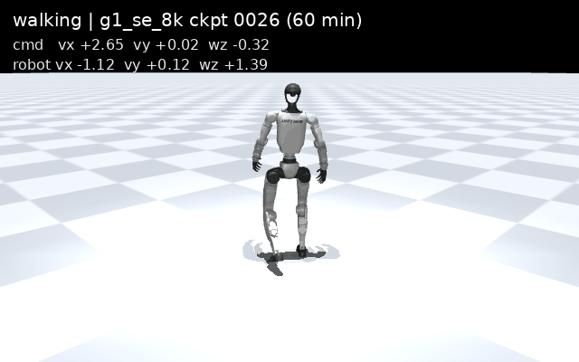
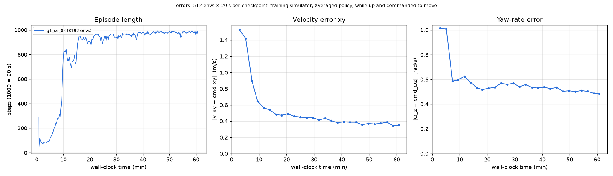

# InstantAMP

Train one policy per robot to walk, run and get up after a fall. A locomotion motion prior rewards gait style. A recovery motion prior provides the style signal on the floor. The learner fits a dynamics model from MuJoCo transitions and updates the policy through imagined rollouts and physical PPO samples.

| Robot | Training task (`--robot`) | Policy inputs | Actions |
| --- | --- | ---: | ---: |
| Unitree G1 | `g1` | 384 | 29 |
| Zenbot 23-DoF | `zenbot23_walk_run_recovery` | 234 | 23 |
| Zenbot 26-DoF | `zenbot26_walk_run_recovery` | 261 | 26 |

Both Zenbots share the training loop, command distribution, reward functions and evaluation criteria. Each uses three frames of Motion Train observations. Joint order, actuator calibration, link geometry and the dimensions derived from joint count follow the selected model. The 26-DoF model adds waist roll, waist pitch and head yaw. [Model definitions](instantamp/zenbot_models.py)

## Setup

The reference training environment uses Linux, Python 3.11, an NVIDIA GPU and a driver compatible with the pinned CUDA and Warp wheels. The G1 reference run used driver 580. Run the following from the checkout.

```bash
python3.11 -m venv .venv
source .venv/bin/activate
python -m pip install -r requirements.txt
JAX_PLATFORMS=cpu python -m pytest -q tests
```

## G1

Install Git LFS, Git and curl for motion preparation. The preparation script downloads the LeggedLab walk/run set and the six Unitree LAFAN1 fall-and-get-up takes, and converts them to 50 Hz NPZ files. Training uses primitive collision geometry. The GIF renderer also needs the Unitree surface meshes. [Motion sources and terms](THIRD_PARTY_NOTICES.md)

```bash
bash tools/download_data.sh
python -m instantamp.train --robot g1 --log_dir runs/g1_joint
python -m instantamp.evaluate runs/g1_joint --last 1
bash tools/download_meshes.sh
python -m tools.render runs/g1_joint
```

## Zenbot

The 23-DoF recipe uses the 17 corrected Motion Train `zenbot_amp_frax_walk_sole8` gait clips in `walk_run` and 11 recovery clips. Gait preparation adjusts narrow steps and levels settled walking stance while preserving heel strike and toe-off. The 26-DoF recipe retargets these gait and recovery clips with FRAX. [Reference checksums](assets/zenbot_wm_reference.sha256) · [Recovery sampling weights](data/zenbot23_walk_run_recovery/recovery/sampling.json)

For new 23-DoF global gait AMP training, commanded velocity selects the motion class. Clips are sampled with their original weights within the class. Slow forward commands use the four start/stop walking references at 0.35× up to 0.30 m/s. From 0.30 to 0.45 m/s the probability of slow playback falls linearly to zero. Pure turns use 0.5× up to 0.60 rad/s and blend back to full speed at 0.90 rad/s. Planar and yaw commands within their 0.10 deadbands select standing. Other classes use full speed. Each window uses one rate on the 50 Hz control grid, with velocities derived from the retimed poses.

To reproduce these banks, supply a Motion Train checkout containing the gait bank for the selected robot and a licensed copy of the prepared LeggedLab `get_up_frax` bank. The latter must contain its manifest and motion pickles under `source/legged_lab/legged_lab/data/MotionData/zenbot_23dof_43kg/amp/get_up_frax`. Access to those source files is a prerequisite for the reference run. To generate the 26-DoF clips, set `FRAX_PYTHON` to an interpreter with `frax[ik]`, JAX, SciPy and MuJoCo. The retarget was tested with FRAX 0.2.0 and MuJoCo 4.0.1 in a separate environment. [Motion Train source revision](https://github.com/ZPLcode/h1_train/tree/4733fc9649dc3f2b99b2c3ba21fb2ec5e259e6ff)

```bash
export MOTION_TRAIN_CHECKOUT=/path/to/motion_train
export LEGGED_LAB_CHECKOUT=/path/to/legged_lab
# For 26-DoF data generation
export FRAX_PYTHON=/path/to/frax-env/bin/python

robot=zenbot23_walk_run_recovery  # or zenbot26_walk_run_recovery
run="runs/$robot"
bash tools/recipes/train_zenbot_joint.sh "$run" --robot "$robot"
```

The script prepares both motion banks, trains from scratch and evaluates the final checkpoint. With the banks already prepared, start the current Zenbot26 recipe directly with the following command.

```bash
python -m instantamp.train --robot zenbot26_walk_run_recovery --log_dir runs/zenbot26_new
```

Edit `Zenbot26JointConfig` to tune fresh 26-DoF runs. Its defaults use 4,096 environments, 100,000 iterations, 500 world-model warmup iterations and a checkpoint every 1,000 iterations. It keeps every policy export and the latest two full learner checkpoints. Zenbot23 defaults to 2,048 environments and 20,000 iterations. Both use 40% floor resets, seed 42 and a world model with three 1,024-unit hidden layers. Each run records its effective settings in `config.json`. [Training recipes](instantamp/train_config.py)

| Shared Zenbot reward setting | Default |
| --- | ---: |
| Planar velocity tracking weight | 2.0 |
| Yaw-rate tracking weight | 1.5 |
| Gait AMP scale (`gait_ls_scale`) | 1.5 |
| AMP mixture weight (`amp_lerp`) | 0.7 |
| Action-rate penalty weight (`action_rate_l2_weight`) | -0.05 |

During straight forward or backward locomotion, `step_length_asymmetry` compares the distances between three alternating ankle touchdowns along the pelvis heading. It allows a difference of 3 cm or 10% of the mean step length, whichever is larger. An extra 10 cm costs 0.05 task reward per landing before AMP mixing. The same event is scored in physics and imagination.

A continuous weight blends recovery and gait using the current pelvis height and uprightness. Its height range is 0.44–0.58 m, and its uprightness range runs from a 60° tilt to 30°. This weight controls the task terms, AMP styles, recovery-discriminator samples and mirror consistency. The global gait discriminator gives every valid sampled robot window equal weight and clips its loss gradient to norm 1.0 before Adam weight decay. The default `amp_lerp=0.7` gives task and AMP rewards coefficients of 0.3 and 0.7 throughout recovery and locomotion. Zenbot26 uses 10 consecutive 50 Hz gait frames and a separate get-up AMP scale of 10. Zenbot23 uses the gait scale of 1.5 for both priors. Quiet-standing reward remains active at a zero command and fades as movement is requested. The lifting-progress reward starts at 0.44 m with weight 0.2 on Zenbot26 and 0.5 on Zenbot23. [Training rewards](instantamp/sim.py) · [AMP mixing](instantamp/train.py)

Both recipes apply a mirror consistency loss of weight 0.2 to imagined frames with an active movement command, weighted by the same posture signal. The log records the unweighted error in `imag_gait_mirror_mse` and the mean posture weight of eligible imagined frames in `imag_gait_mirror_fraction`. Resuming keeps the saved weight, with zero for checkpoints that predate this loss.

New Zenbot23 and Zenbot26 joint runs enable `--motion_train_randomization 1`, following the local Motion Train `ad923704` Zenbot AMP dynamics. Every episode samples a 15–35 ms motor delay independently for each actuator group. Zenbot23 has five groups. Zenbot26 adds one group for waist roll and pitch and one for head yaw. Startup samples PD gains and joint armature at 0.8–1.2 times nominal, calibrated paired leg friction at 0.5–1.5 times the pair mean with at most 10% left/right mismatch, pelvis mass ±3 kg, limb masses at 0.8–1.2 times nominal, and a shared torso/pelvis COM offset of ±3 cm per axis. Zenbot26 uses calibrated joint friction of 0.350 for waist roll and 0.550 for waist pitch. Principal inertias and the physics engine's reference inverse weights are updated with these changes. These startup parameters remain fixed across episode resets.

Zenbot26 trains with the Motion Train shoulder and hip push schedule. Zenbot23 starts with external pushes disabled. Resuming a run preserves its saved push setting. Runs that predate this switch use their original push behavior when resumed.

Terrain weights are 40% flat, 35% mild roughness, 15% medium roughness and 10% slopes. Each world keeps its terrain origin across resets. Heights used by rewards, geometry and recovery AMP are measured relative to the local surface. The world model and critic receive the randomized dynamics as privileged context. The deployed actor uses 234 inputs for Zenbot23 and 261 for Zenbot26. The actor observations use per-step IMU noise and a per-episode IMU delay.

Material sampling follows the active Newton backend: continuous robot sliding friction in [0.3, 1.6], ground friction 1, and equal contact priorities, giving effective ground friction `max(robot_mu, 1)`. The PhysX-only 64 buckets and separate dynamic-friction range are not applied, and no unsupported restitution mapping is invented. Contact uses MuJoCo heightfields rather than Newton's external triangle pipeline; the solver uses 100 iterations, 50 line-search iterations and 35 CCD iterations. Terrain generation does not reproduce Newton's steep-edge vertex displacement. Native playback/evaluation retains its existing fixed flat-ground model and is not an equivalent randomized-environment evaluation.

Both Zenbot models generate the reference terrain at 5 cm spacing, then sample it at 10 cm spacing for physical collisions and reward height queries. This limits the number of triangle candidates per robot collider to MuJoCo Warp's 50-contact pair capacity, including when the robot lies on rough ground.

Exact full-checkpoint continuation retains the saved randomization setting and uses the legacy recipe for configurations that predate this field. The randomization changes the world-model and critic input sizes. To use it with an existing actor of the same articulation, start a fresh learner with `--init_policy RUN/ckpt/NAME.npz`.

Zenbot joint training learns one state-independent Gaussian exploration standard deviation per joint through PPO. Fresh runs start at `--action_noise 1.0` and use `--action_entropy_coef 0.01`. Half the collector environments sample actions and half execute the mean. The log records `action_std_by_joint` in physical joint order. Full checkpoints save the learned values and their Adam state. When continuing an older fixed-noise run, the resume tool initializes them from that run's `action_noise`. Exported actors execute the learned mean.

Zenbot joint training applies a single task penalty when the first rise fails, −2 for Zenbot26 and −1 for Zenbot23 before AMP mixing. It charges once per fall for a lift setback, a refall, or ending the episode before the robot stands upright for one second with foot support on at least 90% of frames. Both fresh and resumed runs use this reward. Physical training and native evaluation count a frame as supported when the feet carry at least half the robot’s weight. Imagination estimates support from sole clearance.

```bash
bash tools/recipes/prepare_zenbot_wm_data.sh --robot "$robot"
python -m instantamp.train --robot "$robot" --help
python -m instantamp.train --robot "$robot" --log_dir "runs/${robot}_experiment"
```

The Zenbot23 100,000-iteration run uses 4,096 environments, ten consecutive gait AMP frames and 500 world-model warmup iterations. The policy starts updating after the warmup. The 100,000-iteration budget includes the warmup.

```bash
python -m instantamp.train --robot zenbot23_walk_run_recovery \
    --num_envs 4096 --max_iterations 100000 --seed 42 \
    --wm_gait_frames 10 --wm_hidden 1024,1024,1024 --wm_only_iters 500 \
    --ckpt_iterations 1000 --log_dir runs/zenbot23_amp10f_wm1024_warm500_4096_100k
```

To initialize from a compatible Motion Train gait export, install `onnx` and `onnxruntime` and run `python -m tools.import_zenbot_gait INPUT.onnx OUTPUT.npz`. Pass `--init_policy OUTPUT.npz` when starting the joint recipe. The importer verifies the converted actions against the ONNX network.

### Evaluation and playback

The native Zenbot evaluator runs the same actor for every trial. It measures heading-aligned speed at 1.0 and 2.5 m/s, alternating foot support and flight periods during running. Each fallen start runs for ten seconds and is scored on the final second of supported standing. The native tools read the recovery bank from the run configuration. Use `--reference DIR` to override it. The training run also contains `config.json`, policy exports in `ckpt/`, and full learner checkpoints in `ckpt/full/`.

```bash
python -m tools.evaluate_zenbot_joint "$run" --out "$run/evaluation/final.json"
python -m tools.play_zenbot_control --checkpoint "$run"
```

The viewer starts in a neutral stance. Use W/S and A/D for linear velocity, Q/E for yaw, X to stop, F to push, R for the next fallen start and Space to pause. It automatically loads matching STL files from `assets/meshes/zenbot_26dof_43kg/` or `assets/meshes/zenbot_23dof_43kg/` according to the policy. A checkout without a complete mesh set displays the visible collision shapes. Pass `--mesh-dir DIR` to load meshes from another directory. Both the viewer and scorer accept an individual policy NPZ. To resume training, pass a full checkpoint and a fresh output directory.

```bash
python -m tools.resume_zenbot_wm releases/zenbot26_scratch_55000/ckpt/full/55000.npz \
    runs/zenbot26_from55000 --until 60000
```

The Zenbot26 continuation from iteration 41,000 uses a gait AMP multiplier of 3, a get-up AMP multiplier of 10 and external pushes. At a zero command, an upright robot with both feet on the ground receives a soft penalty for deviating from its default joint angles. The starting weight is −2 per second before task/style mixing. At rest at the target height, a 10° RMS error across the 26 joints incurs half that penalty. The penalty fades as the base moves, including when the robot reacts to a push. Continuing a checkpoint trained with the earlier recovery rewards, or changing the stance weight, initializes a fresh critic and critic optimizer and restores the actor, world model and motion priors.

```bash
python -m tools.resume_zenbot_wm \
    releases/zenbot26_gait3_push_41000/ckpt/full/41000.npz \
    runs/zenbot26_recovery_control_from41000 --until 46000 \
    --gait-ls-scale 3 --getup-amp-scale 10 --stand-pose-weight -2
python -m tools.evaluate_zenbot_joint runs/zenbot26_recovery_control_from41000 --push-recovery \
    --out runs/zenbot26_recovery_control_from41000/evaluation/final.json
```

The native evaluator also reports first-attempt success, lift setbacks, refalls, time to the first and sustained supported one-second stance, vertical/angular speed, torque, motor saturation and absolute joint work. For Zenbot26, peak tracking starts when the pelvis has risen at least 8 cm from the lowest observed height and reaches at least 30 cm above the ground. A drop of 8 cm from that peak counts as one setback. Independently, a 12 cm rise of the mean shoulder height arms its peak, and a subsequent 12 cm drop counts toward the same setback. Training charges once per fall. The evaluator requires a fresh qualifying rise to count another setback. Zenbot23 retains its 44 cm attempt height. The separate lifting reward uses `wm_lift_gate`, which defaults to 44 cm for both robots. First-attempt success requires final supported standing with no setback or refall. Refalls require 0.2 seconds of lost upright posture after 0.2 seconds of supported upright posture. Effort metrics include retries through the final settling interval, or the full ten seconds on failure, with motor samples at 200 Hz. Compare these alongside walk/run results before choosing a continued policy; final standing success alone can hide retries.

Use `--push-recovery` to additionally test actual falls: after two seconds of standing, the evaluator applies a 0.4-second torso force of 300, 450 or 600 N in each of four directions. After releasing the force, it waits up to two seconds for pelvis height below 44 cm, then scores ten seconds of recovery with the existing velocity and controller history. Pushes that do not cause a fall are reported separately. This reproducible flat-ground stress test supplements the reference starts; it does not reproduce every mouse drag or the randomized training push distribution.

### Exported Zenbot26 checkpoint

The original 55,000-iteration training recipe uses the source revision recorded in the release. [Training source](https://github.com/ZPLcode/InstantAMP/tree/1508cd342753531500394a267533cd0ac54e8d1a)

The 55,000-iteration Zenbot26 checkpoint comes from a fresh 2,048-environment run with external pushes, gait AMP set to 3, get-up AMP set to 10 and a default standing-pose weight of −2. In native MuJoCo it passed the 1.0 m/s walking test, failed the 2.5 m/s running test and recovered from all 12 push-induced falls, nine on the first attempt. The release includes the averaged ONNX policy, resumable learner, training logs and per-trial results. [55,000-iteration release](releases/zenbot26_scratch_55000/README.md)

### Exported Zenbot23 checkpoint

The [74,000-update export](releases/zenbot23_continuous_74000/README.md) includes the policy, complete learner state, configuration, training metrics and native evaluation. Training was stopped at the user's request before the planned 100,000 updates. This checkpoint passed 22/22 fixed recovery trials and tracked a 1.0 m/s command at 0.97 m/s; it reached only 0.86 m/s for a 2.5 m/s command and did not pass the running test. See the export for playback and continuation commands.

## G1 reference results

<p align="center">
  
  
</p>



The GIFs and curves above come from a 60-minute run on one RTX 5090 with 8192 environments. The GIFs show its final checkpoint.
The curves are measured on 512 robots × 20 s per checkpoint, while the robots are up and commanded to move. Episodes are close to
full length (1000 steps) from about 20 minutes on. The velocity error falls to about 0.45 m/s at 30 minutes and 0.35 m/s at 60
minutes.

The table below is the reference run: one RTX 5090 with 4096 environments and the default flags. Compilation took 146 s before
training started, and training ran at 3.4 iterations per second.

| Training time | Episode length (of 1000 steps) | Episodes ending in a fall | Linear tracking (per s) | Get-ups (rose / down starts) |
|---|---|---|---|---|
| 5 min | 85 | 1.00 | 0.008 | 80 / 485 |
| 10 min | 152 | 1.00 | 0.021 | 100 / 117 |
| 15 min | 810 | 0.23 | 0.40 | 34 / 35 |
| 20 min | 949 | 0.07 | 0.70 | 40 / 40 |
| **30 min** | **935** | **0.10** | **0.73** | 27 / 33 |
| 60 min | 993 | 0.01 | 0.80 | 20 / 20 |

The robot learns to get up first (by about 10 minutes) and walks from about 15 minutes on. We rolled out the checkpoint from about
55 minutes for 20 s in 256 environments. It ran upright and symmetrically, with its arms swinging at its sides, at commands up to
2.7 m/s. Its median velocity error was 0.17 m/s, and it fell once.

These numbers come from one seed. Expect some spread between seeds and GPUs.

## Acknowledgements and citation

InstantAMP stands on the following works. If you use it, please cite them.

- **SuperMimic** (Liao et al., 2026): the method, a differentiable world model with analytic policy gradients through imagined
  rollouts. [Paper](https://arxiv.org/abs/2610.28480) · [Code](https://github.com/HybridRobotics/supermimic)
- **InstantTrack** by Huy-Quang Dao: G1 motion tracking in minutes on one GPU, the origin of much of the world-model training
  code (through BlinkMimic and XMimic). [Code](https://github.com/Huy-Quang-Dao/instantTrack)
- **XSoma** (Bohlinger and Peters, 2026): the JAX and MuJoCo Warp implementation that InstantAMP is built on.
  [Paper](https://nico-bohlinger.github.io/papers/2026_xmimic_xsoma.pdf) · [Code](https://github.com/nico-bohlinger/xsoma)
- **ODE Policy** (Jia et al., 2026): the ODE actor (`--ode 1`). [Paper](https://arxiv.org/abs/2611.01729) ·
  [Code](https://github.com/NTUMARS/ODE-POLICY)

Also thanks to:

- AMP (Peng et al., 2021, [arXiv:2104.02180](https://arxiv.org/abs/2104.02180));
- [mjlab](https://github.com/mujocolab/mjlab), for the G1 model and actuator constants;
- the code lineage of [XMimic](https://github.com/nico-bohlinger/xmimic) and [supermimic_vibed](https://github.com/zita-ch/supermimic_vibed);
- [legged_lab](https://github.com/zitongbai/legged_lab) and [LAFAN1](https://github.com/ubisoft/ubisoft-laforge-animation-dataset), for the motion data;
- [MuJoCo](https://mujoco.org), [MuJoCo Warp](https://github.com/google-deepmind/mujoco_warp), [NVIDIA Warp](https://github.com/NVIDIA/warp) and [JAX](https://github.com/jax-ml/jax).

InstantAMP is an independent project. It is not affiliated with or endorsed by the authors above.

```bibtex
@article{liao2026supermimic,
  title   = {SuperMimic: Scaling Humanoid Whole-Body Control with One Differentiable World Model},
  author  = {Liao, Qiayuan and Shao, Yiyang and Long, Junfeng and Zakka, Kevin and Horowitz, Roberto and Abbeel, Pieter and Sreenath, Koushil},
  journal = {arXiv preprint arXiv:2610.28480},
  year    = {2026}
}

@misc{dao2026instanttrack,
  title        = {InstantTrack: Whole-Body Motion Tracking for the Unitree G1 in Minutes on One GPU},
  author       = {Dao, Huy-Quang},
  year         = {2026},
  howpublished = {\url{https://github.com/Huy-Quang-Dao/instantTrack}}
}

@misc{bohlinger2026xmimicxsoma,
  title  = {XMimic and XSoma: Learning Humanoid Motion Tracking and Locomotion in Under a Minute},
  author = {Bohlinger, Nico and Peters, Jan},
  year   = {2026},
  url    = {https://nico-bohlinger.github.io/papers/2026_xmimic_xsoma.pdf}
}

@article{jia2026odepolicy,
  title   = {ODE Policy: Robot Learning via Action Dynamics, Not Actions},
  author  = {Jia, Jindou and Li, Jingliang and Zuo, Kuangji and An, Tuo and Hu, Yuxuan and Zhao, Mengfei and Lyu, Bofan and Bai, Jiaqi and Zhu, Daoyuan and Dai, Hengyu and Zhang, Junpeng and Yang, Jianfei},
  journal = {arXiv preprint arXiv:2611.01729},
  year    = {2026}
}

@article{peng2021amp,
  title   = {AMP: Adversarial Motion Priors for Stylized Physics-Based Character Control},
  author  = {Peng, Xue Bin and Ma, Ze and Abbeel, Pieter and Levine, Sergey and Kanazawa, Angjoo},
  journal = {ACM Transactions on Graphics},
  volume  = {40},
  number  = {4},
  year    = {2021}
}
```

## License

InstantAMP code is distributed under MIT. The robot descriptions, motion datasets and upstream components have their own terms. [Project license](LICENSE) · [Third-party notices](THIRD_PARTY_NOTICES.md) · [Contributing](CONTRIBUTING.md)
